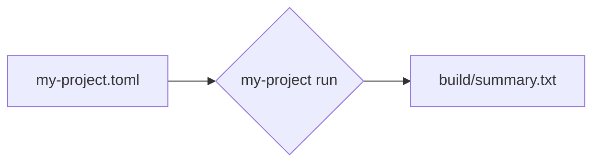

# 快速开始

从一个空目录开始，得到第一个结果。

1. 新建项目目录：`mkdir hello && cd hello`
2. 把下面的配置保存为 `my-project.toml`
3. 运行 `my-project run`，结果写入 `build/summary.txt`。
{.steps}

```toml title="my-project.toml"
[project]
name = "hello"
output = "build/"
```

## 发生了什么



> [!NOTE]
> 中文站只放最常用的几页。没有翻译的页面，读者可以通过右上角的语言菜单切换到英文版。
