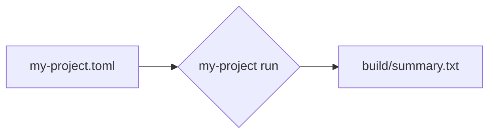

# Quick start

This page gets you from an empty folder to a first result.

1. Create a project folder: `mkdir hello && cd hello`
2. Save the configuration below as `my-project.toml`
3. Run `my-project run`. The summary is written to `build/summary.txt`.
{.steps}

```toml title="my-project.toml"
[project]
name = "hello"
output = "build/"
```

## What just happened



> [!WARNING]
> Diagrams like this one are drawn in the browser. They need the site to be served over HTTP, not opened as a file.

## Next steps

- Learn every option in [Configuration](../reference/configuration.md).
- Read the [release notes](../releases.md) before upgrading.
